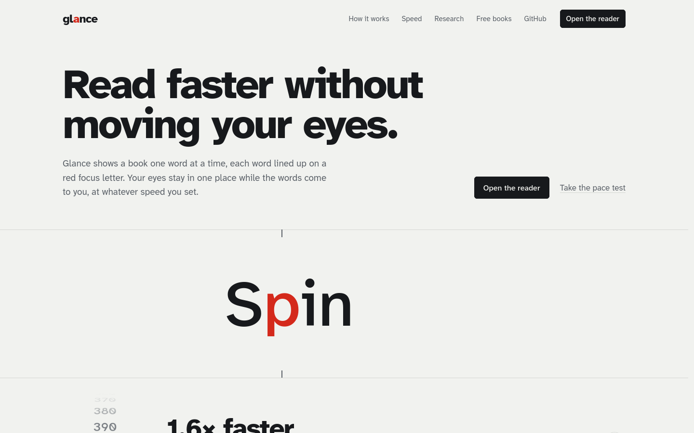

# Glance

**Read faster without moving your eyes.** Glance shows a book one word at a time, with each word lined up on a red focus letter, so your eyes stay still and the words come to you.

**Use it:** https://abhijit-s999.github.io/glance/



## What it does

- **Choose a speed with the dial**, a drum you spin like the one on a phone's alarm clock. Or take the **pace test**: short passages with one question each, nudging you slower or faster until you find a speed you can follow.
- **Open your own books:** `.txt`, `.epub` and `.pdf`, all read in your browser. Or start with ten public-domain classics.
- **Chapters**, with time left in the chapter and a chapter list.
- **Pause to look back:** the paragraph appears with your place underlined. Click any word to carry on from there.
- **Compare with normal reading:** how long each book takes at a typical 250 words a minute and at your speed, plus a running total of words read.
- **Private and offline.** No account, no upload, no tracking, and no third-party requests (the fonts and libraries are served from this repo). Once you've visited, it works offline and can be installed like an app.

## How the reading works

- **Focus letter.** The highlighted letter sits a little left of the word's middle, close to the optimal viewing position for word recognition (O'Regan & Jacobs, 1992).
- **Time in proportion to length.** The speed you pick is the average for words. Each word gets a share in proportion to its length, so at 550 wpm "it" flashes for 72 ms and "discriminative" stays for 335 ms. Words shorter than three letters are timed as three. You can blend this back toward the same time for every word.
- **Fixed pauses for blinking.** Commas and dashes, sentence ends and new paragraphs each get a pause in milliseconds (default 100, 200 and 400). The pauses don't shrink as you speed up, and each one is adjustable. Time estimates and comparisons include them.
- **Any word size.** A slider from 50% to 400%, pinch on touch screens, a trackpad pinch, or the − and + keys.
- **Built around the known limits** of rapid serial visual presentation. These are fewer regressions (Schotter, Tran & Rayner, 2014), fewer blinks (Benedetto et al., 2015) and lower comprehension at high speeds (Ricciardi & Di Nocera, 2017). The landing page has the full references.

## Run it locally

It's a static site with no build step:

```sh
python3 -m http.server 8000
# open http://localhost:8000/
```

## Layout

| Path | What it is |
| --- | --- |
| `index.html`, `assets/site.*` | Landing page |
| `read/index.html`, `assets/app.*` | The reader app |
| `assets/core.js` | Shared engine: tokenizer, timing, chapter detection, the dial, the shelf |
| `assets/glance.css` | Shared tokens and components |
| `books/` | Free public-domain books and `catalog.json` (built by `tools/prepare_books.py`) |
| `sw.js` | Offline support. Bump `VERSION` when you deploy. |
| `assets/vendor/` | pdf.js 3.11.174 (Apache 2.0) and JSZip 3.10.1 (MIT) |
| `assets/fonts/` | Atkinson Hyperlegible Next and Mono, Literata, Lexend (SIL Open Font License) |

## Credits

The free books are public-domain texts transcribed by Project Gutenberg volunteers. They were cleaned up with `tools/prepare_books.py`, which strips the licence header and footer. Set in Atkinson Hyperlegible Next by the Braille Institute.

## License

MIT. See [LICENSE](LICENSE).
